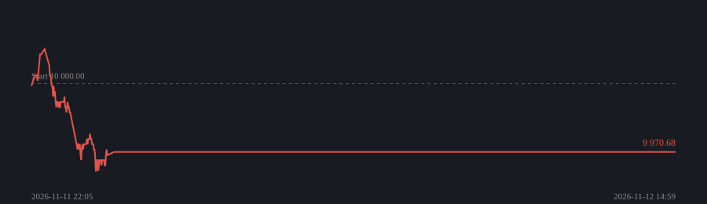
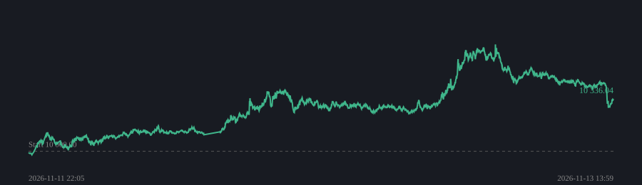

# Krypto-trendbot (papperstrading)

Körs automatiskt varje timme på GitHub och ombalanserar en gång per dygn. Inga riktiga pengar.

Detaljerade rapporter: trend_rapport_live.html och trend_rapport_live_langkort.html (ladda ner och öppna i webbläsaren).

## Trendbot (bara lång)

Igång sedan 2026-11-11 22:05 · uppdaterad 2026-11-13 22:59 (UTC)

| | |
|---|---|
| Kapital | **9 970.68 USDT** (-0.29%) |
| Köp & håll samma tid | -4.30% |
| Avslutade affärer | 1 (0 % vinster) |
| Snitt per affär | -2.76% |
| Bästa | -2.76% PEPEUSDT |
| Sämsta | -2.76% PEPEUSDT |

Rädsla/girighet: **20** (Extreme Fear)  

| Position | Sida | Insats | Resultat |
|---|---|---|---|
| (inga) | | | |

## Trendbot (lång + kort)

Igång sedan 2026-11-11 22:05 · uppdaterad 2026-11-13 22:59 (UTC)

| | |
|---|---|
| Kapital | **10 574.92 USDT** (+5.75%) |
| Köp & håll samma tid | -4.24% |
| Avslutade affärer | 8 (88 % vinster) |
| Snitt per affär | +2.40% |
| Bästa | +5.12% BTCUSDT |
| Sämsta | -2.55% PEPEUSDT |

Rädsla/girighet: **20** (Extreme Fear)  
Spärrade p.g.a. nyheter: BTCUSDT  

| Position | Sida | Insats | Resultat |
|---|---|---|---|
| BNBUSDT | Kort | 1 024.72 | +8.06% |
| BONKUSDT | Kort | 370.17 | +3.89% |
| DOGEUSDT | Kort | 908.75 | +6.22% |
| ETHUSDT | Kort | 837.19 | +6.99% |
| SOLUSDT | Kort | 968.49 | +8.06% |
| WIFUSDT | Kort | 882.86 | +6.00% |
| XRPUSDT | Kort | 850.73 | +5.12% |
| ADAUSDT | Kort | 646.89 | +4.25% |
| FLOKIUSDT | Kort | 612.54 | +2.76% |
| LINKUSDT | Kort | 621.94 | +3.68% |
| SHIBUSDT | Kort | 421.31 | +2.70% |
| SUIUSDT | Kort | 314.12 | +1.71% |
