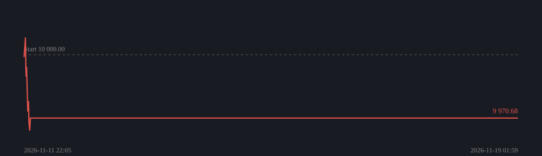
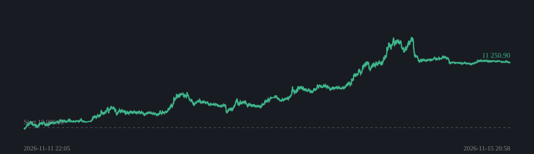

# Krypto-trendbot (papperstrading)

Körs automatiskt varje timme på GitHub och ombalanserar en gång per dygn. Inga riktiga pengar.

Detaljerade rapporter: trend_rapport_live.html och trend_rapport_live_langkort.html (ladda ner och öppna i webbläsaren).

## Trendbot (bara lång)

Igång sedan 2026-11-11 22:05 · uppdaterad 2026-11-17 22:59 (UTC)

| | |
|---|---|
| Kapital | **9 970.68 USDT** (-0.29%) |
| Köp & håll samma tid | -11.66% |
| Avslutade affärer | 1 (0 % vinster) |
| Snitt per affär | -2.76% |
| Bästa | -2.76% PEPEUSDT |
| Sämsta | -2.76% PEPEUSDT |

Rädsla/girighet: **12** (Extreme Fear)  

| Position | Sida | Insats | Resultat |
|---|---|---|---|
| (inga) | | | |

## Trendbot (lång + kort)

Igång sedan 2026-11-11 22:05 · uppdaterad 2026-11-17 22:59 (UTC)

| | |
|---|---|
| Kapital | **11 212.53 USDT** (+12.13%) |
| Köp & håll samma tid | -11.62% |
| Avslutade affärer | 18 (94 % vinster) |
| Snitt per affär | +7.00% |
| Bästa | +13.79% BONKUSDT |
| Sämsta | -2.55% PEPEUSDT |

Rädsla/girighet: **12** (Extreme Fear)  
Spärrade p.g.a. nyheter: SOLUSDT  

| Position | Sida | Insats | Resultat |
|---|---|---|---|
| BNBUSDT | Kort | 1 024.72 | +13.42% |
| DOGEUSDT | Kort | 908.75 | +12.81% |
| ETHUSDT | Kort | 837.19 | +12.34% |
| BTCUSDT | Kort | 1 131.20 | +0.65% |
| PEPEUSDT | Kort | 440.99 | +2.01% |
| ADAUSDT | Kort | 707.45 | -0.77% |
| AVAXUSDT | Kort | 635.82 | -1.19% |
| BONKUSDT | Kort | 540.36 | -1.76% |
| FLOKIUSDT | Kort | 666.48 | +1.90% |
| LINKUSDT | Kort | 670.67 | -1.26% |
| SHIBUSDT | Kort | 869.46 | +0.21% |
| SUIUSDT | Kort | 647.46 | -1.79% |
| WIFUSDT | Kort | 645.36 | -0.27% |
| XRPUSDT | Kort | 56.30 | -1.91% |
