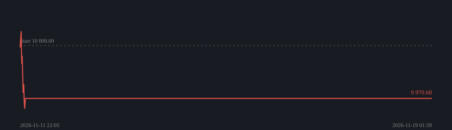

## Trendbot (bara lång)

Igång sedan 2026-11-11 22:05 · uppdaterad 2026-11-16 16:59 (UTC)

| | |
|---|---|
| Kapital | **9 970.68 USDT** (-0.29%) |
| Köp & håll samma tid | -11.99% |
| Avslutade affärer | 1 (0 % vinster) |
| Snitt per affär | -2.76% |
| Bästa | -2.76% PEPEUSDT |
| Sämsta | -2.76% PEPEUSDT |

Rädsla/girighet: **10** (Extreme Fear)  

| Position | Sida | Insats | Resultat |
|---|---|---|---|
| (inga) | | | |
