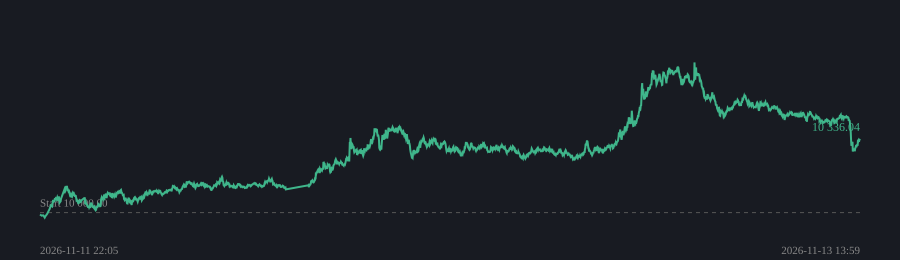

## Trendbot (lång + kort)

Igång sedan 2026-11-11 22:05 · uppdaterad 2026-11-12 09:05 (UTC)

| | |
|---|---|
| Kapital | **10 141.22 USDT** (+1.41%) |
| Köp & håll samma tid | -2.40% |
| Avslutade affärer | 1 (0 % vinster) |
| Snitt per affär | -2.55% |
| Bästa | -2.55% PEPEUSDT |
| Sämsta | -2.55% PEPEUSDT |

Rädsla/girighet: **28** (Fear)  

| Position | Sida | Insats | Resultat |
|---|---|---|---|
| BNBUSDT | Kort | 1 510.37 | +1.94% |
| BONKUSDT | Kort | 370.17 | +4.25% |
| DOGEUSDT | Kort | 1 239.60 | +2.36% |
| ETHUSDT | Kort | 1 208.73 | +1.17% |
| SOLUSDT | Kort | 1 349.64 | +1.99% |
| WIFUSDT | Kort | 882.86 | +2.12% |
| XRPUSDT | Kort | 1 206.55 | +1.64% |
| BTCUSDT | Kort | 1 568.26 | +0.58% |
