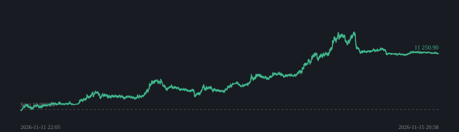

## Trendbot (lång + kort)

Igång sedan 2026-11-11 22:05 · uppdaterad 2026-11-19 03:59 (UTC)

| | |
|---|---|
| Kapital | **11 314.70 USDT** (+13.15%) |
| Köp & håll samma tid | -12.58% |
| Avslutade affärer | 19 (95 % vinster) |
| Snitt per affär | +7.24% |
| Bästa | +13.79% BONKUSDT |
| Sämsta | -2.55% PEPEUSDT |

Rädsla/girighet: **10** (Extreme Fear)  

| Position | Sida | Insats | Resultat |
|---|---|---|---|
| BNBUSDT | Kort | 1 024.72 | +14.76% |
| ETHUSDT | Kort | 837.19 | +13.33% |
| BTCUSDT | Kort | 1 131.20 | +2.98% |
| PEPEUSDT | Kort | 440.99 | +3.04% |
| ADAUSDT | Kort | 707.45 | +0.47% |
| AVAXUSDT | Kort | 635.82 | +0.72% |
| BONKUSDT | Kort | 540.36 | -1.76% |
| FLOKIUSDT | Kort | 666.48 | +3.42% |
| LINKUSDT | Kort | 670.67 | +0.31% |
| SHIBUSDT | Kort | 869.46 | +0.98% |
| SUIUSDT | Kort | 647.46 | -0.80% |
| WIFUSDT | Kort | 645.36 | +0.62% |
| XRPUSDT | Kort | 770.42 | +1.12% |
| DOGEUSDT | Kort | 819.74 | -0.49% |
| SOLUSDT | Kort | 573.06 | -0.93% |
